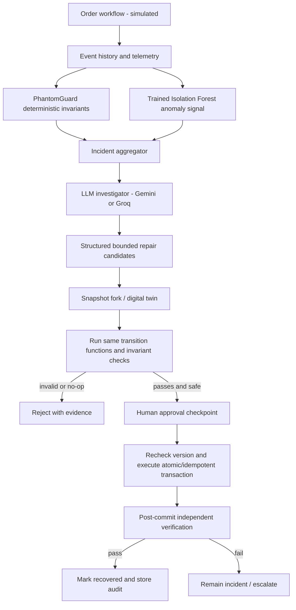

# MirrorHeal AI + PhantomGuard — Master Research, Architecture & 6-Hour Build Plan

**Event:** CODE E FIESTA 2026 — Medi-Caps University × SlowBros Labs  
**Track:** 04 — The Self-Healing AI Automation System  
**Research checked:** 28 October 2026  
**Status:** Implementation blueprint, **not a claim that the app has already been built**  
**Development environment:** Windows + Cursor recommended; macOS/Linux supported

> **One-sentence pitch:** MirrorHeal detects business failures that ordinary HTTP status monitoring misses; a custom-trained anomaly detector and rule engine flag incidents; an LLM proposes bounded repairs; a digital twin compares actual outcomes; and a transactional recovery engine executes only validated, approved actions.

---

## 0. START HERE — Decision and sprint constraints

**Build this, and nothing bigger, for the judged MVP:** A fictional e-commerce order processing system. An order for **one laptop** gets **two active inventory reservations** after a duplicated event, while the API reports success. PhantomGuard detects the violation; Gemini/Groq explains evidence and proposes actions; MirrorHeal clones the state and simulates alternatives; only the verified compensation is approved and committed; database checks prove one active reservation remains. Separately, an Isolation Forest model trained on **synthetic normal telemetry** flags an unusually slow/retried workflow that has no hard business-rule violation; this remains **investigation only**, not automatic repair.

**Hard requirements (P0):**
1. Create normal order with SQLite persistence and event records.
2. Inject one reproducible duplicate-reservation silent failure.
3. Run deterministic invariants and record incident evidence.
4. Train, save, load, evaluate and actually invoke an Isolation Forest on saved telemetry.
5. Invoke one real hosted LLM with a schema-validated root-cause analysis and repair candidates; clearly disclose fallback mode if API is unavailable.
6. Simulate three strategies using copied state and the **same** transition logic as real operations.
7. Reject harmful/no-op strategies using independent invariants and preventative checks.
8. Require operator approval and apply a conditional, idempotent transaction to the simulated business database.
9. Prove success from post-commit database queries; repeat recovery is a no-op.
10. Show end-to-end evidence in a React web dashboard.

**P1 after P0 passes:** ML-only anomaly scenario, an interactive dependency graph, repair history metrics, event history replay. **P2 after hackathon:** API schema drift, service failover, production connectors, full digital twins, distributed traces, online learning.

**Do not build in six hours:** real payment gateway, autonomous arbitrary SQL/shell commands, untrusted generated code execution, full Kubernetes monitoring, model fine-tuning, multiple microservices, cloud orchestration, production-grade inventory accounting, authentication/multi-tenancy, or a vector DB.

**Success definition:** a real DB value changes from **two active reservations to one**, under a simulator-approved and human-approved plan, with tests and logs proving it happened. A pretty dashboard alone does not count.

---

## 1. Explain it simply

### Story A — Known but invisible failure (deterministic rules)
- A customer orders 1 laptop; order API returns `200 OK`.
- An at-least-once event is delivered twice. The deliberately faulty simulation handler creates reservations `R1` and `R2` for the same logical event.
- Rule: `sum(active_reservations for order) == order.quantity` during the reserved stage. Actual = 2, expected = 1.
- The anomaly ML model can additionally score the event burst; **the hard rule alone proves an error**.
- Gemini reads the event/DB evidence and proposes `RETRY_ORDER`, `MARK_EVENT_PROCESSED`, or `RELEASE_EXTRA_RESERVATION + RECORD_EVENT_DEDUP`.
- The simulator independently executes each plan on a snapshot. Retrying makes no useful correction (or has adverse effects), marking alone leaves over-reservation, and the combined compensation can satisfy all checks.
- Approval → transaction updates the exact extra reservation to `released`, adjusts the stock projection safely, records event deduplication, and writes an audit record.
- Post-commit re-query proves one active reservation, no negative stock, no repeated compensation.

### Story B — Unknown/unusual behavior (our trained ML model)
- An order reserves exactly the right quantity, so hard business rules pass.
- Telemetry contains unusual event count, retry count, or processing latency.
- Isolation Forest outputs an anomaly indicator and raw decision score. It **does not** prove corruption or select a fix.
- The UI says `Unusual execution — investigate`, and AI reviews supporting evidence. If insufficient evidence, it recommends `ESCALATE` / monitor, **not mutate data**.

**Why combine ML and rules?** Rules find specific, proven violations; an anomaly detector broadens coverage to unfamiliar patterns. Neither substitutes for verified recovery.

---

## 2. Research-backed engineering decisions

| Question | Decision for 6h | Why |
|---|---|---|
| Train a new LLM? | **No** | No relevant dataset, compute, or time; use a pretrained model as reasoning/planning service. |
| Train any model? | **Yes, Isolation Forest** | Fast CPU training and a credible independently evaluated ML component. |
| ML supervised vs unsupervised? | **Isolation Forest on normal telemetry** | Normal data is easier to simulate; don't claim a definitive diagnosis from anomalies. |
| Business-rule detector? | **Pure Python invariants** | Exact known constraints should be deterministic. |
| LLM primary? | **Gemini structured JSON** | API provides machine-readable diagnosis; validate again with Pydantic. |
| LLM backup? | **Groq (supported strict-schema model)** | Backup for service/quota issues; response always goes through the same local validation. |
| Workflow orchestration? | **Simple Python state machine** | LangGraph/Temporal would consume setup time without adding essential MVP functionality. |
| Digital twin? | **Deep-copied state and pure transition functions** | Fast, reproducible, isolated; call it a *workflow-state twin*, not a production twin. |
| Persistence? | **SQLite + SQLModel** | Small, relational, zero external infra, supports transactions/unique keys. |
| Presentation? | **React + Tailwind + simple flow cards** | Clear before/after, fast iteration. React Flow only after core works. |
| Safety? | **Allowlisted actions + validation + manual approval + idempotency** | LLM must never be authorized to execute arbitrary code or commands. |

The model's JSON format guarantees neither semantic accuracy nor safe actions; structural and semantic validation belong in our backend. Training metrics on synthetic data are not evidence of real-world accuracy. Approval is enforced in server code, not requested merely in a model prompt.

---

## 3. Recommended complete stack (locked P0)

| Layer | Libraries / tech | Purpose | Must-have? |
|---|---|---|---|
| IDE and AI coding | **Cursor Agent**, Git, GitHub | Work in short validated implementation phases | Yes |
| Web UI | **React, Vite, TypeScript** | 3-page control panel | Yes |
| Styling | **Tailwind CSS, Lucide React** | Premium dark UI, colored state cues | Yes |
| Flow graph | **@xyflow/react** | Connected order/payment/inventory/shipping nodes | P1 |
| Component kit | shadcn/ui | Reusable UI primitives | P1 |
| API backend | **Python 3.11+, FastAPI, Uvicorn** | CRUD, detection, AI bridge, recovery | Yes |
| Input/output contracts | **Pydantic v2** | Validate requests, LLM responses, repair schema | Yes |
| Database | **SQLite, SQLModel/SQLAlchemy** | Atomic state, records, approvals | Yes |
| Trained model | **Scikit-learn IsolationForest** | Unsupervised anomaly signals | Yes |
| Dataset tools | **NumPy, Pandas** | Generate and evaluate synthetic workflow telemetry | Yes |
| Artifact persistence | Joblib (trusted local artifact only) | Save/load fitted pipeline | Yes |
| Reasoning LLM | Google Gen AI Python SDK (`google-genai`) | Diagnose and propose bounded repairs | Yes |
| Backup LLM | `groq` SDK | Provider fallback behind common interface | P1 |
| Stateful simulator | Python `copy.deepcopy`, dataclasses / Pydantic | Each proposed fix evaluated independently | Yes |
| Testing | **pytest, FastAPI TestClient**, httpx | Endpoint and property-like invariant tests | Yes |
| Visualization metrics | Simple UI counts; Recharts | Recovery dashboard | P1 |
| Hosting | Local `localhost:5173` + `localhost:8000` | Reproducible venue demo | Yes |
| Advanced workflow | LangGraph, Temporal | Durable/interruptible production flow | **No** for MVP |
| Observability | OpenTelemetry, Grafana | Distributed tracing after MVP | No |
| Queue | Redis/Celery | Worker scaling after MVP | No |
| Embeddings/vector DB | Chroma/Pinecone/pgvector | Not needed for scoped event diagnosis | No |

**Alternative stacks:** Full TypeScript (Next.js, Prisma, PostgreSQL, Vercel AI SDK) if everyone knows TS; Streamlit + FastAPI if speed matters more than UI polish; LangGraph + PostgreSQL for a later persistent-agent system. **Do not switch stacks halfway through the sprint.**

---

## 4. AI APIs, free plans, accounts and environment

### 4.1 Primary: Google Gemini
1. Open <https://aistudio.google.com/api-keys>, sign in, create API key.
2. Check access and current quotas in <https://aistudio.google.com/rate-limit>.
3. Choose an eligible free model; at research date, **`gemini-3.5-flash-lite`** is listed as a free-tier text model. Check actual model availability and rate tier before the event: <https://ai.google.dev/gemini-api/docs/models>, <https://ai.google.dev/gemini-api/docs/pricing>.
4. Store `GEMINI_API_KEY` only in `backend/.env`. Never use it in browser code or Git.
5. Validate small structured JSON requests; do not send real customer names, financial details, API secrets, or private logs. Google's free tier may have different data-use terms from paid plans.

### 4.2 Backup: Groq
- Keys: <https://console.groq.com/keys>.
- Structured output/model compatibility: <https://console.groq.com/docs/structured-outputs>.
- Example supported strict-schema model: `openai/gpt-oss-20b` (reconfirm on event date).
- Rate limits: <https://console.groq.com/docs/rate-limits> (account-level restrictions vary).
- Backup must not silently switch model results into a canned answer. Show `AI provider: Gemini/Groq/Unavailable`.

### 4.3 Offline LLM alternative
- Ollama: <https://ollama.com/>. Only consider if you have enough RAM/compute, model pre-downloaded, and tested latency. Training Isolation Forest requires **no GPU**.

### 4.4 Environment file
```dotenv
# backend/.env (NEVER commit)
GEMINI_API_KEY=replace_with_secret
GEMINI_MODEL=gemini-3.5-flash-lite
GROQ_API_KEY=
GROQ_MODEL=openai/gpt-oss-20b
AI_PROVIDER=gemini
DATABASE_URL=sqlite:///./mirrorheal.db
ALLOWED_ORIGIN=http://localhost:5173
ENABLE_FAULT_INJECTION=true
```
**`.env.example`** should contain empty placeholders, not secrets. Never paste API keys into Cursor chats, screenshots, issue trackers, logs or exported prompts.

### 4.5 API integration contract
The Gemini and Groq adapters must expose a single Python interface:
```python
class InvestigatorProtocol(Protocol):
    def diagnose(self, evidence: IncidentEvidence) -> Diagnosis: ...
```
`Diagnosis` contains `root_cause`, `evidence_ids`, `explanation`, and `plans` (1–3 plans), **not SQL or Python source**. On API error, return `AI_UNAVAILABLE`; allow manual read-only inspection or a clearly marked deterministic baseline.

**LLM budget guideline:** 1 call per incident; cap evidence to a few KB; timeout ~10–20 seconds; retry at most once if safe and within quota; cache by incident evidence hash for repeated demo clicks. Never claim the exact provider quota without checking the account dashboard.

---

## 5. Architecture and event sequence



**Important:** Detection and repair are not the same decision. ML high anomaly alone => investigate; a proven incorrect reservation state can be compensated only after exact duplicate identification and safety checks.

### 5.1 Workflow state machine
`CREATED → PAYMENT_VERIFIED → INVENTORY_RESERVED → SHIPPING_REQUESTED → COMPLETE`. `FAILED` and `INVESTIGATING` are incident labels, not irreversible order stages. All payment steps are **simulated**: no real charges.

### 5.2 Simulated fault injection
Expose a demo-only button `Inject duplicate reservation` for `ORD-101`. It deliberately bypasses idempotency for a single **synthetic** logical event and creates two active reservation rows sharing `logical_event_id`. Ordinary processing remains deduplicated. Visibly label this a **controlled fault injection**, not a real-world outage.

### 5.3 Correct simulation semantics
Create an immutable `WorkflowSnapshot` from database records. For **each** candidate plan, deep-copy the same baseline, then apply **shared pure transition functions**. Do not mutate global state or SQLite during simulation. Score candidates only from observable outputs/invariants; no pre-written “success” flags.

Three candidates for this precise scenario:
1. `RETRY_ORDER`: either no-op due to idempotency or extra mutation if deliberately faulty; over-reservation unresolved => **rejected**.
2. `RECORD_EVENT_DEDUP` alone: prevents future duplicates but leaves 2 active reservations => **rejected**.
3. `RELEASE_EXTRA_RESERVATION(R2)` **plus** `RECORD_EVENT_DEDUP(EVT-101)`: after independent identification of one uncommitted duplicate and restoration of stock ledger, post-state has 1 active reservation and dedup guard => **passes**, subject to approval.

The combined plan must be atomic as a transaction. If multiple possible duplicate reservations exist and cannot be disambiguated reliably, **escalate** rather than guessing.

---

## 6. Data model and database schema

Use SQLite with SQLModel models (explicit `ForeignKey`/unique indexes where appropriate). Every timestamp UTC ISO 8601. Store all monetary amounts as **integer paise** if simulated prices are needed; do not float money.

| Entity/table | Essential columns | Constraint/invariant |
|---|---|---|
| `orders` | `id`, `sku`, `quantity`, `status`, `version`, `created_at` | quantity > 0; version increments for state changes |
| `inventory` | `sku`, `initial_stock`, `available_stock`, `version` | available_stock >= 0 |
| `inventory_reservations` | `id`, `order_id`, `logical_event_id`, `attempt_id`, `qty`, `status`, `committed_at`, `released_at` | qty > 0; released row cannot be released again |
| `workflow_events` | `id`, `logical_event_id`, `attempt_id`, `order_id`, `step`, `result`, `duration_ms`, `retry_no`, `created_at` | physical event ID distinct from logical event ID |
| `processed_events` | `logical_event_id`, `order_id`, `processed_at` | unique logical event ID to deduplicate routine operations |
| `incidents` | `id`, `order_id`, `source`, `type`, `status`, `evidence_json`, `created_at`, `resolved_at` | statuses OPEN/DIAGNOSED/APPROVAL_PENDING/RECOVERED/ESCALATED |
| `repair_plans` | `id`, `incident_id`, `actions_json`, `model_provider`, `explanation`, `created_at` | allowlist actions; cannot persist arbitrary code |
| `simulations` | `id`, `plan_id`, `before_json`, `after_json`, `checks_json`, `passed`, `created_at` | candidate ran on snapshot; no DB writes to business state |
| `recovery_attempts` | `id`, `incident_id`, `plan_id`, `operation_key`, `approved_by`, `status`, `before_version`, `after_version`, `created_at` | unique operation_key; repeat = no-op |
| `telemetry` | `id`, `order_id`, `event_count`, `retry_count`, `duration_ms`, `ordered_qty`, `reservation_count`, `model_score`, `created_at` | features as-of scoring time, not future labels |

**Simplification:** Keep all tables in one SQLite database; use JSON columns as text with Pydantic serialization for structured evidence; no need for database migrations during MVP. The app initializer can create tables automatically on empty DB, and an explicit `reset_demo.py` resets **only the demo DB**, after confirmation.

### 6.1 Version and idempotency rules
- `orders.version` read during simulation. On commit, update only if version still matches (optimistic check) and verify plan/incident state.
- `recovery_attempts.operation_key` uniquely identifies one approved recovery. Re-running the same operation must not change reservation or inventory balances.
- Release a reservation only when status is `active`, it belongs to that order/logical event, it has not been fulfilled/shipped, and the reservation evidence uniquely identifies it as extra.
- Any failed precondition => transaction rollback + incident stays unresolved.

---

## 7. ML component — train the Isolation Forest honestly

**Goal:** Detect unusual *workflow telemetry*, not assert that an order is fraudulent or corrupted.

### 7.1 Features (all available at scoring time)
`event_count`, `retry_count`, `processing_time_ms`, `order_quantity`, `active_reservation_count`, `distinct_step_count`. Keep feature order fixed and documented. For example, unusually many retries and long duration despite no hard-rule failure can be flagged for diagnosis.

**Do not include** `is_anomaly`, `fault_type`, `repair_success`, `post_recovery_status`, or future-only information as features. That would leak the answer.

### 7.2 Synthetic data generation
- Generate ~1,500 **normal** samples using reproducible `numpy.random.default_rng(42)`. Preserve realistic relationships: event count near expected step count, retry count mostly 0, duration positive with long-tail variation, reservation count consistent with ordered quantity.
- Generate independent holdout: ~300 novel normal samples and ~150 deliberate anomalies from different seeds. Include event storms, repeated retries, unusually long durations, and duplicate reservations. Have *benign slow-but-correct* cases to expose false positives.
- Randomize within plausible ranges, not independent random features with contradictory combinations.
- Split before any fitting or threshold selection. Train ONLY on normal train set; calibrate cutoff using a validation subset; evaluate exactly once on a held-out test set. Document synthetic limits.
- Preserve the generator seed, feature list, scaler (if any), estimator, threshold and sklearn version in metadata. Use `joblib` only on artifacts generated by your own trusted process; it can execute code on load.

### 7.3 Training pipeline
Recommended estimator:
```python
from sklearn.ensemble import IsolationForest
model = IsolationForest(n_estimators=100, contamination=0.03, random_state=42)
model.fit(X_normal_train)   # exactly the same ordered columns at inference
score = model.decision_function(X_test)
flags = model.predict(X_test)  # -1 = anomaly; +1 = inlier
```
The `contamination` setting influences expected outlier proportion/threshold; it is **not** a verified error probability. Expose raw decision scores and threshold, not fabricated “98% confident” badges. A separate normalized UI severity index may be used, but label it clearly as *derived* rather than a probability.

### 7.4 Evaluation and results
Calculate confusion matrix, precision, recall, F1 on simulated labels, false-positive rate and false-negative cases. Compare:
- Rule engine alone (certain known failures).
- Isolation Forest alone (unusual telemetry).
- Combined rule OR anomaly alerts (broader coverage, potentially more false positives).

**Never claim 99% accuracy unless measured on held-out data.** Save `data/evaluation.json` and render those actual numbers in UI. Real-world validation would require genuine production traces later.

### 7.5 Runtime integration
`POST /orders/{id}/process` records telemetry → `POST /orders/{id}/inspect` runs hard rules and ML inference. ML-only alert creates `source="ML"` incident requiring investigation; it must not auto-authorize a state change. If model artifact missing, show `ML_UNAVAILABLE` and keep deterministic pipeline functional.

---

## 8. LLM diagnosis contracts and control plane

### 8.1 Evidence payload (sanitized)
```json
{
  "incident_id": "INC-101",
  "order_id": "ORD-101",
  "rules": [{"id": "RESERVATION_MATCH", "passed": false, "expected": 1, "actual": 2}],
  "ml": {"flagged": true, "decision_score": -0.08, "model_version": "iforest-v1"},
  "events": [
    {"attempt_id": "A1", "logical_event_id": "EVT-101", "type": "inventory_reserved"},
    {"attempt_id": "A2", "logical_event_id": "EVT-101", "type": "inventory_reserved"}
  ],
  "reservations": [
    {"id": "R1", "event_id": "EVT-101", "status": "active", "quantity": 1},
    {"id": "R2", "event_id": "EVT-101", "status": "active", "quantity": 1}
  ],
  "allowed_actions": ["RETRY_ORDER", "RECORD_EVENT_DEDUP", "RELEASE_EXTRA_RESERVATION", "ESCALATE"]
}
```
The numbers above are *example evidence*, not measured results from an app.

### 8.2 Bounded diagnosis response
```json
{
  "root_cause": "DUPLICATE_EVENT_PROCESSING",
  "explanation": "The same logical event created two active reservations.",
  "evidence_ids": ["A1", "A2", "R1", "R2"],
  "plans": [
    {"plan_id": "P1", "actions": [{"type": "RETRY_ORDER", "target_id": "ORD-101"}]},
    {"plan_id": "P2", "actions": [{"type": "RECORD_EVENT_DEDUP", "target_id": "EVT-101"}]},
    {"plan_id": "P3", "actions": [
      {"type": "RELEASE_EXTRA_RESERVATION", "target_id": "R2"},
      {"type": "RECORD_EVENT_DEDUP", "target_id": "EVT-101"}
    ]}
  ]
}
```
Pydantic validates JSON structure, enums, nonempty IDs, max plan/actions counts and references that exist in actual evidence; a backend verifier checks contextual feasibility. **Do not blindly execute plan P3 because the model prefers it**.

### 8.3 Security
- No LLM-generated SQL, Python, bash, arbitrary URLs, shell/tool execution or schema migrations.
- Treat logs and event text as untrusted data (prompt injection risk); put only necessary fields into context.
- Keep separate human approval for all actual compensation actions.
- Only allow a fixed, auditable tool registry. LLM can recommend `ESCALATE` when uncertain.
- Fail closed on invalid JSON, missing evidence IDs, model timeout, or high-risk ambiguity.

---

## 9. Digital twin, candidate scoring, and transactional recovery

### 9.1 Independent state simulator
Pure functions:
```text
load_snapshot(order_id) -> WorkflowSnapshot
apply_action(snapshot, SupportedAction) -> WorkflowSnapshot | ValidationError
simulate_plan(deepcopy(snapshot), plan) -> SimulationResult
run_invariants(snapshot) -> list[InvariantResult]
rank_passed_candidates(results) -> candidate for human approval
```
Checks include: `reservation_qty == ordered_qty` for inventory-reserved orders, stock >= 0, no duplicated active reservation for same logical event, no release of already shipped/consumed stock, no repeated compensation. A pass must also satisfy prevention condition (dedup rule is recorded/enforced), not only restore the current count.

### 9.2 Ranking
1. Discard plans that violate a rule or leave the incident unresolved.
2. Discard unsafe, ambiguous, or unauthorized actions.
3. Among passing plans, prefer fewer state changes and lower modeled impact; rank is advisory.
4. Save detailed `before`, `after`, and per-check evidence.
5. Request explicit human approval before live simulation DB mutation.

### 9.3 Transactional commit
`POST /incidents/{id}/recover` consumes a plan approved via a separate approval endpoint. It checks row/version, reservation ownership, ship status, duplicate evidence, operation key uniqueness. In one transaction mark extra reservation released, update available stock consistently, mark event processed, store attempt and audit; read back to verify. If constraints fail, rollback and escalate. If post-commit verification fails due to a complex issue, **do not pretend an automatic rollback occurred**; keep incident open/escalate and use a separate compensating operation as appropriate. The MVP should avoid non-transactional external side effects.

**Don't equate approval with validation:** approval is a permission gate; simulation+invariants are independent technical gates.

---

## 10. Backend endpoints (stable contract)

| Method | Endpoint | Purpose | Response/guard |
|---|---|---|---|
| GET | `/api/health` | DB/ML/LLM configured status | `200`; never expose secrets |
| POST | `/api/demo/reset` | Reset demo dataset | disabled except local demo; explicit confirmation |
| POST | `/api/orders` | Create fictional order | order + normal reservations/event history |
| GET | `/api/orders/{id}` | Get current order and reservations | 404 if missing |
| POST | `/api/orders/{id}/inject-duplicate` | Inject controlled fault | demo mode only; records new attempt |
| POST | `/api/orders/{id}/inspect` | Run rule engine and trained ML | statuses/rules/scores; may create incident |
| GET | `/api/incidents` | List incidents | summaries/statuses |
| GET | `/api/incidents/{id}` | Evidence and current state | sanitized fields |
| POST | `/api/incidents/{id}/diagnose` | Real LLM analysis | 1–3 typed plans, AI provider, version |
| POST | `/api/incidents/{id}/simulate` | Run each plan on snapshot | before/after/checks, rejected reasons |
| POST | `/api/incidents/{id}/approve` | Explicit operator approves exact plan | persisted approval, expires if state changes |
| POST | `/api/incidents/{id}/recover` | Apply validated approved plan | atomic commit, rechecks, idempotent key |
| GET | `/api/metrics` | Incident counts / recovery time | actual DB-calculated values |
| GET | `/api/ml/metrics` | Model metadata and holdout evaluation | measured values + synthetic data disclaimer |

### 10.1 Standard errors and contract conventions
- Use Pydantic DTOs and one common frontend API client; display field validation errors.
- `400/422`: unsupported/invalid candidate, `404`: missing, `409`: stale version/conflicting replay, `423` or `403`: unapproved or blocked, `502/503`: AI unavailable.
- Return `request_id`, `incident_id`, `model_provider` where relevant; never leak API key or stack trace in client responses.
- Idempotency key belongs in recovery payload/header and DB unique field.
- Avoid auto-running external model calls from page refresh; invoke only from an explicit investigation action.

---

## 11. UI: only three screens

### Screen A — Mission Control
Top KPI row: healthy workflows, rule incidents, ML-only anomalies, recovery success (counts derived from DB). Main panel: `Order → Payment → Inventory → Shipping` step visualization; create order, inject fault, inspect buttons; live event history table. Indicate that all orders and services are simulated, and API `200 OK` does not imply invariants pass.

### Screen B — AI Investigation
For one incident: observed vs expected quantity, event table, rule results, ML anomaly raw score, Gemini explanation, grounded evidence IDs, proposed actions. Badges: RULE VIOLATION / ML ANOMALY / AI UNAVAILABLE. Do not display invented model confidence.

### Screen C — Simulation Lab / Recovery
Show the three **actual calculated** candidate outcomes: starting state, ending state, invariant checks, why rejected, which plans are approvable, approval button, recovery status, post-commit verification, audit entry. State changes should update the incident and dashboard.

**UI style:** dark navy / charcoal, subtle gold or cyan accent, green for verified, amber for investigating, red for failed. Keep body readable; no elaborate animated 3D globe. Use standard CSS/cards first, add React Flow later.

---

## 12. Folder layout and configuration

```text
mirrorheal/
├── AGENTS.md                   # Cursor project guidance
├── MIRRORHEAL_MASTER_PLAN.md
├── CURSOR_EXECUTION_GUIDE.md
├── .cursor/rules/mirrorheal.mdc
├── .gitignore
├── README.md
├── frontend/
│   ├── src/
│   │   ├── pages/{Dashboard,Investigation,SimulationLab}.tsx
│   │   ├── components/{WorkflowView,IncidentList,PlanCompare,ApprovalDialog}.tsx
│   │   ├── lib/api.ts
│   │   └── types/contracts.ts
│   └── package.json
└── backend/
    ├── .env.example
    ├── requirements.txt
    ├── app/
    │   ├── main.py
    │   ├── db.py
    │   ├── models.py
    │   ├── schemas.py
    │   ├── routes/{orders,incidents,ml}.py
    │   ├── core/{workflow,events,detectors}.py
    │   ├── ai/{provider,gemini_adapter,groq_adapter}.py
    │   ├── healing/{actions,twin,verifier,executor}.py
    │   └── ml/{features,inference}.py
    ├── scripts/{seed_demo,generate_dataset,train_model,eval_model}.py
    ├── artifacts/                 # local trusted model + metadata
    ├── data/                      # synthetic train/test + metrics
    └── tests/{test_workflow,test_detector,test_ml,test_twin,test_recovery,test_api}.py
```

**Create files only when needed.** Do not spend 40 minutes making empty folders, complex configuration, or speculative abstractions.

---

## 13. Windows setup + commands

**Prerequisites:** Python 3.11+, Node compatible with current Vite (currently Node 20.19+ or 22.12+), Git, Cursor. Validate `python --version`, `node --version`, `npm --version`, `git --version` first.

```powershell
mkdir mirrorheal
cd mirrorheal
npm create vite@latest frontend -- --template react-ts
cd frontend
npm install
npm install tailwindcss @tailwindcss/vite lucide-react
# Add React Flow only for P1: npm install @xyflow/react
cd ..
mkdir backend
cd backend
python -m venv .venv
.\.venv\Scripts\Activate.ps1
python -m pip install --upgrade pip
pip install fastapi "uvicorn[standard]" sqlmodel pydantic python-dotenv google-genai groq
pip install scikit-learn numpy pandas joblib pytest httpx
```

Configure Tailwind per <https://tailwindcss.com/docs/installation/using-vite> (Vite plugin + `@import "tailwindcss";`). Start backend from `backend` with `uvicorn app.main:app --reload --port 8000`; frontend with `cd frontend; npm run dev`. Configure backend CORS for `http://localhost:5173`, not unrestricted wildcard in deployed environments.

**Check health:** <http://localhost:8000/docs> and <http://localhost:5173>. For API test, use Swagger UI or a PowerShell `Invoke-RestMethod` call.

---

## 14. Exact 6-hour execution plan (time-boxed)

| Clock | Owner / work | Concrete acceptance gate | Fallback |
|---|---|---|---|
| 0:00–0:20 | All: confirm scope, keys, versions, contracts, agree one incident scenario | `README`, endpoints, schema agreed; one Gemini smoke test works | Groq or marked deterministic analysis mode |
| 0:20–1:00 | Backend + UI: skeleton, tables, normal order processing; ML: dataset generator | Creating order persists one correct reservation | UI shows basic cards only |
| 1:00–2:00 | Backend: duplicate fault + invariant detector; ML: train/eval; UI: order graph | 200-OK order has two active reservations, incident appears; model scored | Keep ML optional if it blocks core |
| 2:00–3:00 | AI: structured Gemini diagnosis; backend: action schemas; UI: incident details | Real model proposes typed candidates with evidence IDs | Read-only diagnosis fallback visibly labeled |
| 3:00–4:00 | Simulator developer: pure transitions, isolated candidates, independent verifier; ML integration | 3 strategies actually execute and 1 passes | Drop graph animations/charts |
| 4:00–5:00 | Backend: approve + atomic commit; UI: connect all buttons | Real DB repaired; replay doesn't change state | Trim to two candidates if needed |
| 5:00–5:30 | All: tests, failure handling, UI polish, verify measured metrics | Automated tests pass + manual script passed | Fix backend correctness before style |
| 5:30–6:00 | Pitch/demo/handoff; commit before buzzer | 90-second real demonstration + repository readme + backups | Use recorded working demo if venue network fails; clearly disclose recorded |

**Decision gates:** If normal persisted order not working by 1h → freeze UI styling. If incident detector not working by 2h → stop ML extras. If digital twin not working by 4h → cut graph/UI polish and prioritize one verified repair. No code after buzzer.

### Team division
- Member 1: React/TypeScript dashboard, API integration, UX.
- Member 2: SQLite/SQLModel normal workflow, detector, API and event logging.
- Member 3: synthetic telemetry, Isolation Forest training/evaluation + LLM adapter and schemas.
- Member 4: pure transition functions, digital twin, safety validator, transaction/replay tests.

For 3 members, combine members 3 and 4 with backend support; reduce UI scope. For 2, drop full ML integration until recovery passes; one good real pipeline beats features that don't run.

### Git coordination
Create `main`, and at most `frontend`, `backend`, and `ml` branches with owned files. Agree contracts before parallel coding. Commit after each working gate. Only one team member edits shared models/schema at a time. Avoid simultaneous Cursor agents editing the same files. Use PR/merge only after tests; if short on time, one integrator owns the main branch.

---

## 15. Definition of Done / acceptance test matrix

| ID | Test | Expected |
|---|---|---|
| T01 | Create normal order q=1 | 1 active reservation, zero incidents |
| T02 | Inject duplicate event | API may report success; 2 active reservations persist |
| T03 | Run rule detector | Incident proves expected 1 vs actual 2 |
| T04 | Train model and run held-out eval | Artifact + raw real metrics; tests excluded from training |
| T05 | ML-only event burst / slow retry, consistent inventory | ML alert; no automatic mutation |
| T06 | Gemini diagnosis | Real API returns Pydantic-valid allowed plans and evidence IDs |
| T07 | Gemini unavailable | Status AI_UNAVAILABLE; original DB unchanged |
| T08 | Simulate `RETRY_ORDER` | Does not resolve violation; rejected |
| T09 | Simulate `RECORD_EVENT_DEDUP` | Existing extra reservation remains; rejected |
| T10 | Simulate combined compensation+dedup | 1 active, stock consistent, all checks pass |
| T11 | Simulate any plan | SQLite business state **unchanged** during simulation |
| T12 | Recover without approval | Blocked |
| T13 | Approve and commit verified plan | One reservation released, audit row written, post-check passed |
| T14 | Repeat same recovery operation key | No second release / no double stock adjustment |
| T15 | Change order version after simulation | Stale approval/plan blocked with conflict |
| T16 | Try to release a shipped or unrelated reservation | Escalated/rejected |
| T17 | LLM proposes unknown action / bad target | Rejected before any execution |
| T18 | Check exposed API and Git diff | No API keys, secrets, real customer PII |

Commands (from backend): `python -m pytest -q`; from frontend: `npm run build`. Make Cursor show **actual** pass/fail terminal output at each gate, not a made-up completion report.

**Critical evaluation metrics:** `rule_true_positives`, `ML precision/recall/F1 on synthetic holdout`, `false_alarm_rate`, `incident count`, `verified recovery count`, `recovery time`, `prevented duplicate recoveries`. Metrics from tests or DB only, never fabricated percentages.

---

## 16. Pitch and 90-second live demo

**Opening (10s):** “What if your API returns success but your business data is wrong? Traditional error monitors can miss it.”

**Fault (15s):** Show order 1 laptop, API success, inject duplicate event, two actual active reservations.

**Detection (15s):** PhantomGuard shows deterministic mismatch; display Isolation Forest model details or a separate ML-only example.

**Intelligence (15s):** Click Diagnose; show real Gemini provider, evidence IDs, and three proposed repairs.

**Digital twin (20s):** Click Simulate; two candidate repairs rejected by independent checks, one candidate passes on its own copy.

**Recovery (10s):** Approve, commit, refresh actual DB view to one reservation; show repeat-safe idempotency result.

**Close (5s):** “We don't trust an AI suggestion blindly; we prove a repair in a twin and verify it after execution.”

**Judge Q&A preparation:**
- *What did you train?* Isolation Forest on synthetic normal workflow telemetry; provide sample size, feature list and held-out metrics.
- *What did Gemini do?* Explanation and bounded repair planning, not mutation.
- *What if AI is wrong?* Typed plan allowlist + simulation + invariants + manual approval + version checks.
- *Is this a production digital twin?* No: isolated **workflow-state twin** for a simulated commerce pipeline.
- *What is novel?* Integrated silent-failure detection + trained anomaly signal + counterfactual repair evaluation + post-commit verification.
- *How do you know the fix worked?* Actual DB state and automated assertions, not model opinion.

---

## 17. Risks, mitigations, and scope control

| Risk | Early warning | Mitigation |
|---|---|---|
| Team lacks tested API access | Gemini smoke test fails at minute 15 | Configure Groq; never block detector/simulator on LLM |
| Synthetic training too easy | Holdout achieves suspicious 100%; feature shortcuts | Independent seeds and benign anomalies; report limitations |
| ML flags many legitimate cases | False positive rate high | Threshold tune on validation; ML investigation-only |
| Model outputs unsupported actions | Pydantic or reference validation fails | Reject + request escalation; no unsafe execution |
| AI hallucination | Explanation cites absent IDs | Evidence-reference validation and independent verification |
| Twin and actual logic diverge | Simulation passes but live commit fails | Shared transition rules and re-check versions at commit |
| Duplicate compensation | Repeated button click releases again | Unique `operation_key` + transaction guard |
| Cursor changes too many files | Agent breaks passing tests | One scoped task per chat; review diff/terminal; commit checkpoint |
| Internet outage | Hosted model request stalls | Explicitly labeled deterministic demo mode + screen recording |
| 6-hour deadline | Sim not done by hour 4 | Stop P1/P2 additions; only one tested recovery |

---

## 18. After-hackathon upgrades (not MVP claims)

1. Multitenant PostgreSQL, API authentication, scoped permissions and strong audit trails.
2. OpenTelemetry traces and real queue/webhook sources; safely sanitized event collection.
3. LangGraph checkpointing or Temporal durable workflows for long-running jobs.
4. Property-based and mutation testing of compensation engine.
5. Better ML: real telemetry evaluation, drift detection, time-window features, calibration and retraining approval process.
6. Shadow traffic/canary releases rather than single in-memory workflow snapshot.
7. Verified schema transformation and fallback-service strategies with richer incident coverage.

---

## 19. Current documentation and research references

Official materials checked for this plan (recheck pricing/models before event):

- Cursor Agent and working with tools: <https://cursor.com/docs/agent/overview>
- Cursor project rules + `AGENTS.md`: <https://cursor.com/docs/rules>
- Gemini models: <https://ai.google.dev/gemini-api/docs/models>
- Gemini pricing: <https://ai.google.dev/gemini-api/docs/pricing>
- Gemini rate limits: <https://ai.google.dev/gemini-api/docs/rate-limits>
- Gemini structured output: <https://ai.google.dev/gemini-api/docs/structured-output>
- Groq structured output (model-dependent): <https://console.groq.com/docs/structured-outputs>
- Groq rate limits: <https://console.groq.com/docs/rate-limits>
- Scikit-learn Isolation Forest: <https://scikit-learn.org/stable/modules/generated/sklearn.ensemble.IsolationForest.html>
- Scikit-learn data leakage/pipelines: <https://scikit-learn.org/stable/common_pitfalls>
- Scikit-learn model persistence security: <https://scikit-learn.org/stable/model_persistence.html>
- FastAPI SQLModel/SQLite tutorial: <https://fastapi.tiangolo.com/tutorial/sql-databases/>
- React Flow setup: <https://reactflow.dev/learn>
- Vite Node compatibility/setup: <https://vite.dev/guide/>
- Tailwind + Vite installation: <https://tailwindcss.com/docs/installation/using-vite>
- OWASP LLM prompt injection and action safeguards: <https://cheatsheetseries.owasp.org/cheatsheets/LLM_Prompt_Injection_Prevention_Cheat_Sheet.html>
- OWASP high-impact human approvals: <https://owasp.github.io/DevSecOpsGuideline/2-Process/2-2-Develop/2-2-5-AI-Agent-and-MCP-Security/>

**Important research limitation:** These sources explain framework capabilities and best practices; they do **not** prove our app works or that this approach guarantees hackathon success. Validation comes from our own code, measured results and judge-facing demo.

---

**Next file:** Read [`CURSOR_EXECUTION_GUIDE.md`](./CURSOR_EXECUTION_GUIDE.md) for exact Cursor prompts to implement each time-boxed step. Place [`AGENTS.md`](./AGENTS.md) and [`.cursor/rules/mirrorheal.mdc`](./.cursor/rules/mirrorheal.mdc) in the repository before opening Cursor Agent.
